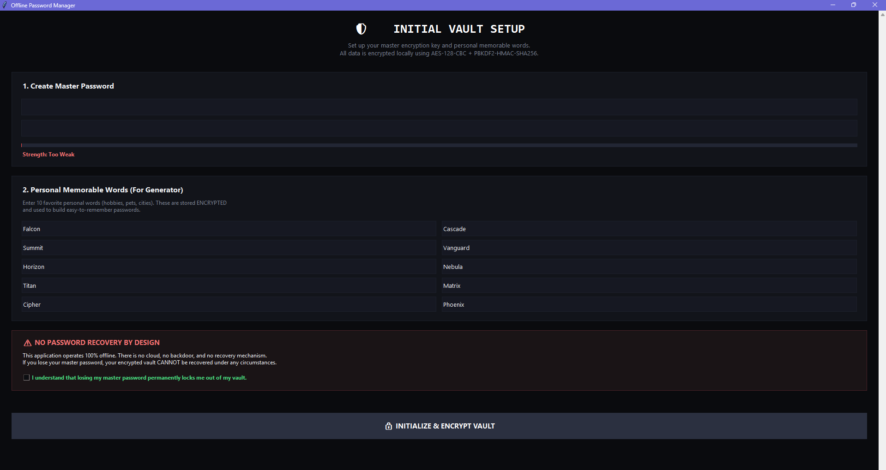
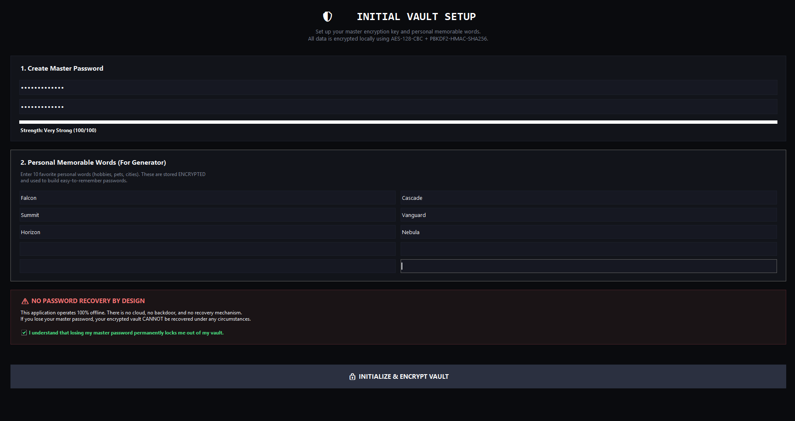
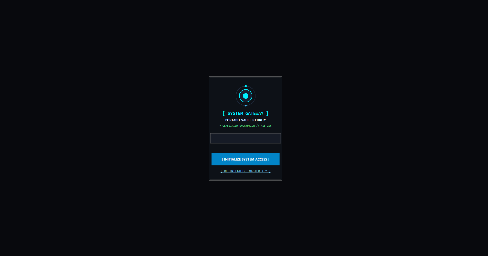
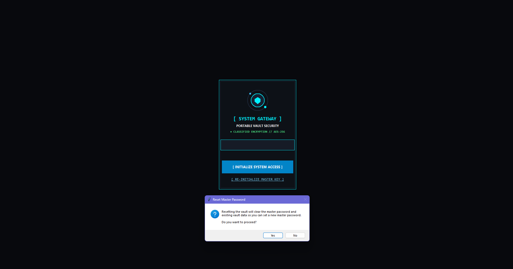
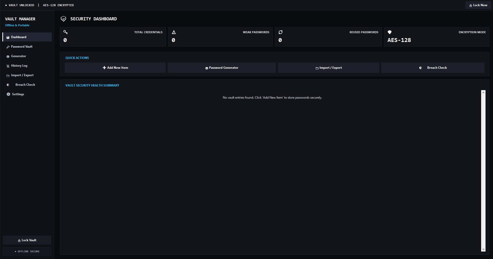
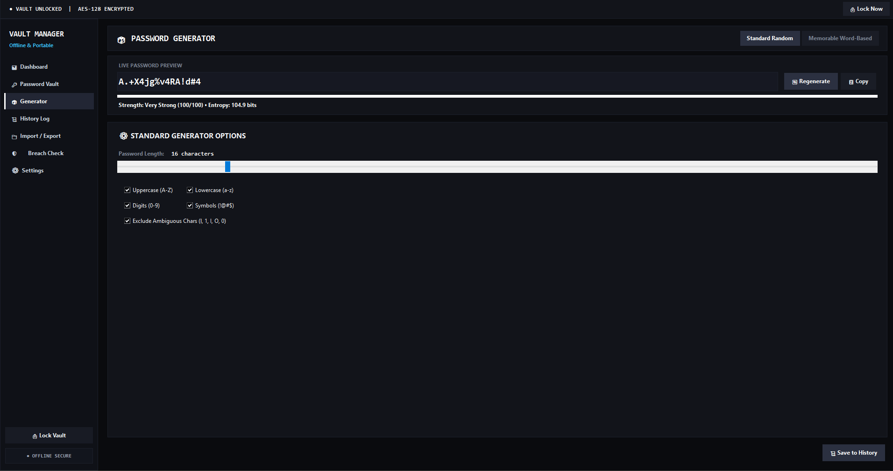
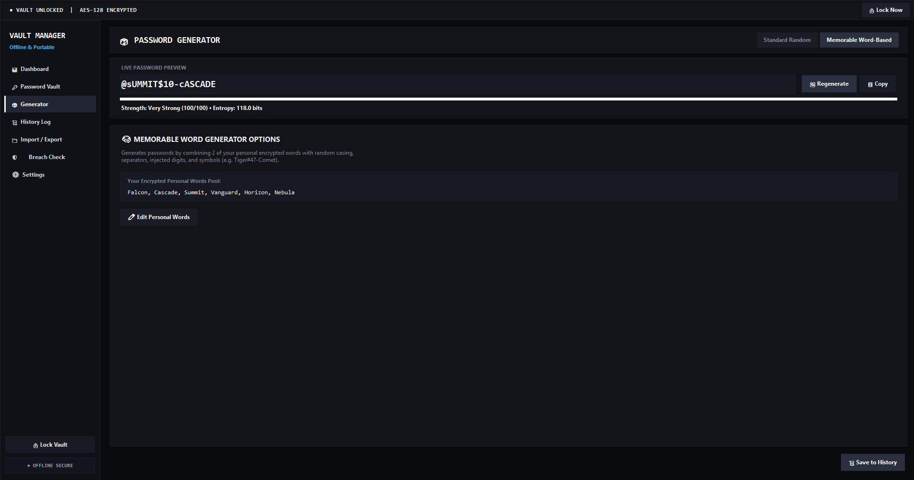
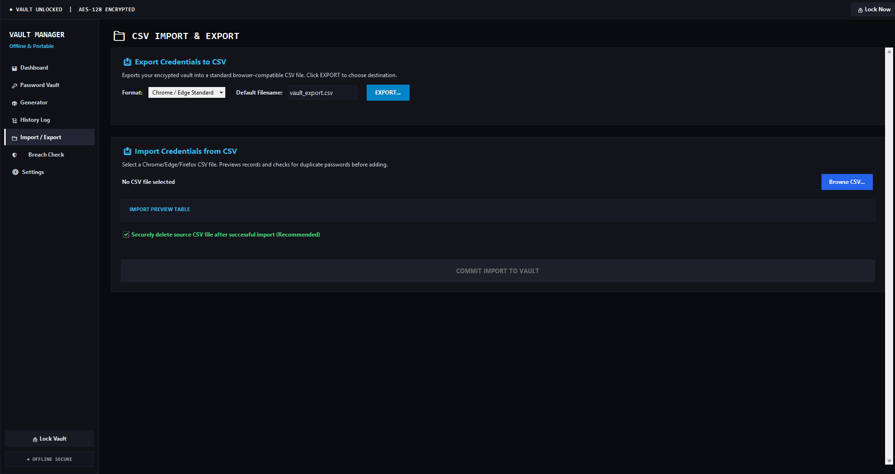
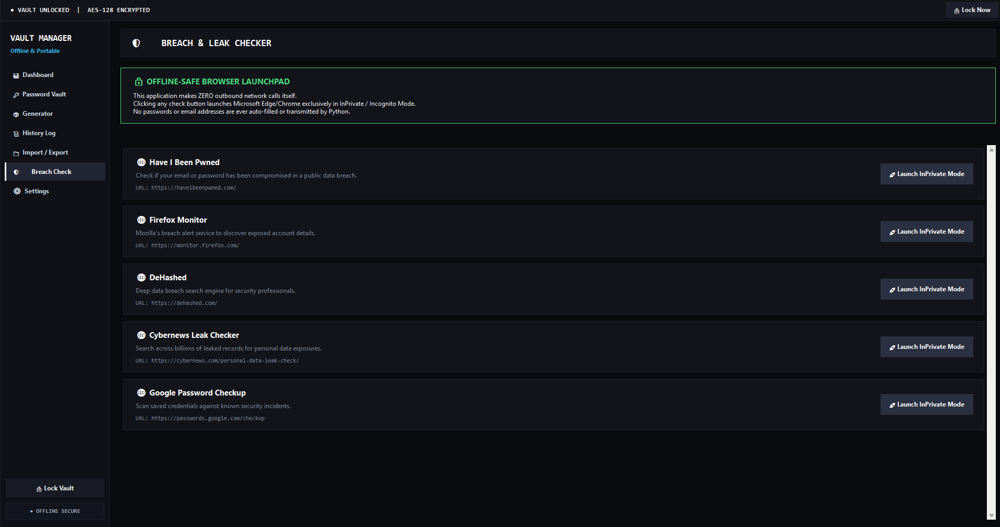
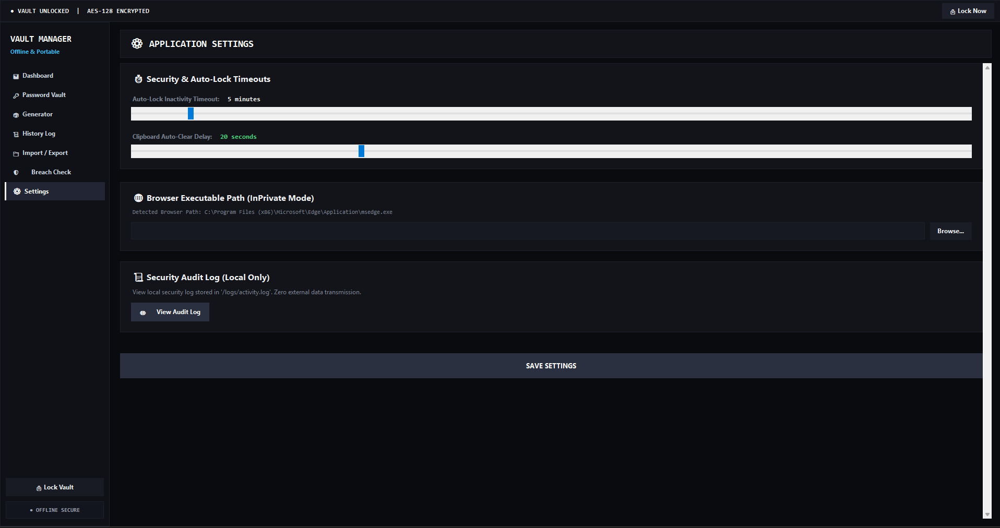

# 🛡️ Offline Password Manager & Security Evaluator

A **100% offline, zero-knowledge desktop password manager** designed for local credential encryption, password strength analytics, and secure credential storage. 

> **Project Classification**: Basic / Educational Cybersecurity & Desktop Application Project.

---

## 📌 Project Objective

The primary objective of this project is to provide a local-first, zero-cloud security tool that allows users to manage, generate, and evaluate passwords without transmitting sensitive credentials over the internet or storing them in plain text.

---

## 🎯 Problem Solved

1. **Cloud Data Breaches**: Third-party cloud password managers risk centralized data breaches. This app operates 100% offline with zero network connectivity or remote data sync.
2. **Weak & Reused Passwords**: Users often reuse simple passwords across sites. The app features built-in entropy scoring and a 10,000-word leaked password dictionary checker.
3. **Plain-Text File Storage**: Plain-text CSV exports or text files are vulnerable to theft. Vault entries are encrypted on disk using AES-128 (Fernet) derived via PBKDF2-HMAC-SHA256.
4. **Unsafe CSV Export Cleanup**: Standard file deletion leaves recoverable data on disk. This project includes DOD-compliant 3-pass file shredding for imported CSV files.

---

## ⚡ Key Features

- **🔒 Zero-Knowledge Local Storage**: All vault records are encrypted on disk using Fernet (AES-128-CBC + HMAC) and PBKDF2 key derivation (100,000+ iterations).
- **📊 Sci-Fi Cybernetic Dashboard**: Real-time security health score, weak/reused password detectors, and white vector status indicators.
- **🎲 Password Generator**:
  - *Standard Generator*: Customizable length, character sets, and exclusion of ambiguous characters (`l`, `1`, `I`, `O`, `0`).
  - *Memorable Word Generator*: Uses personal memorable words to construct easy-to-remember passphrase combinations.
- **📁 CSV Import & Custom Export**:
  - *Interactive Save File Dialog*: Prompt to save exported CSV files (`Chrome`, `Edge`, `Firefox` formats) to any directory on your computer.
  - *Secure File Shredder*: Option to securely overwrite (shred) imported CSV files (3-pass random overwrite).
- **🛡️ Sci-Fi Hologram Gateway & Master Password Reset**:
  - Interactive radar ring canvas animation and biometric scanning sequence on unlock.
  - Built-in Master Password Reset workflow.
- **📜 Local Security Audit Logging**: Local-only timestamped audit log (`logs/activity.log`) recording app activity and security events.

---

## 🛠️ Tools & Technologies Used

- **Programming Language**: Python 3.12+
- **GUI Framework**: `Tkinter` (Native Desktop GUI) & `PIL` (Pillow for vector image/canvas rendering)
- **Cryptography**: Python `cryptography` library (`Fernet` AES-128, `PBKDF2HMAC`, `SHA256`)
- **Executable Compilation**: `PyInstaller` (standalone executable bundle and installer build)
- **Shell & Launch Scripts**: Windows Batch (`.bat`) & PowerShell

---

## 🖼️ Application Screenshots & Interface Preview

### 1. 📝 Master Password Setup (Registration Phase 1)
First-time setup screen allowing users to configure a secure master password with real-time strength evaluation.


---

### 2. 🛡️ Master Password Setup Confirmation (Registration Phase 2)
Second step of registration for confirming the master password and initializing local PBKDF2 encryption.


---

### 3. 🔒 Login Screen
The authentication for unlocking the encrypted vault.


---

### 4. 🔑 Master Password Reset Workflow
Secure reset flow for re-keying or setting up a new master password.

> ⚠️ **Zero-Knowledge Emergency Reset**: Because the app uses 100% offline local encryption without remote recovery backdoors, resetting the master password requires a **complete security wipe of existing vault data**. Previous passwords cannot be recovered once wiped.



---

### 5. 📊 Sci-Fi Cybernetic Security Dashboard
Main overview dashboard showing vault health score, total credentials count, weak/reused password alerts, and security metrics.


---

### 6. 🎲 Standard Password Generator
Customizable password generator supporting custom length, special characters, uppercase/lowercase, and exclusion of ambiguous characters (`l`, `1`, `I`, `O`, `0`).


---

### 7. 🧠 Memorable Passphrase Generator
Passphrase generator combining personal memorable words with numbers and symbols for easy-to-remember passwords.


---

### 8. 🔑 Encrypted Vault & New Credential Entry
Interface for browsing stored credentials, viewing details, and adding new entries with automatic local AES-128 encryption.


---

### 9. 📁 CSV Import & Custom Export Manager
Import passwords from browser CSV files (`Chrome`, `Firefox`, `Edge`), export vault entries, and securely shred imported files via 3-pass overwrite.


---

### 10. 🛡️ Password Breach Checker
Isolated, privacy-focused breach lookup tool that launches external security breach verification services in **Edge InPrivate / Incognito mode** to prevent session tracking.

**Supported Breach Checking Services:**
- 🔍 **[Have I Been Pwned](https://haveibeenpwned.com/)** — Primary database check for exposed emails and pwned password leaks.
- 🦊 **[Firefox Monitor](https://monitor.firefox.com/)** — Mozilla's official data breach notification and exposure monitor.
- 🕵️ **[DeHashed](https://dehashed.com/)** — Deep breach search engine for credential leak analysis.
- 📰 **[Cybernews Leak Checker](https://cybernews.com/personal-data-leak-check/)** — Multi-billion record search engine for personal data exposures.
- 🌐 **[Google Password Checkup](https://passwords.google.com/checkup)** — Credential safety scanner for Google account saved passwords.



---

### 11. ⚙️ App Settings & Preferences
Application configuration panel for managing display options, local logs, and security settings.


---

## 📁 Repository Code Structure

```text
Password-Strength-Checker/
├── PasswordManager.py          # Main Application Entry Point
├── Launch_App.bat              # 1-Click Windows Launcher Script (Bypasses SmartScreen)
├── build_installer.py          # PyInstaller Executable & Installer Build Automation
├── user_installer.py           # Per-user non-admin installation script
├── README.txt                  # Application Documentation
├── README.md                   # GitHub Repository Overview & Documentation
│
├── Snapshots/                  # Application Screenshots & UI Previews
│   ├── 1-Register-Phase.png
│   ├── 2-Register-Phase.png
│   ├── 3-Login.png
│   ├── 4-Forget-masterpwd.png
│   ├── 5-Dashboard.png
│   ├── 6S-tanderd-Pwd-Gen.png
│   ├── 7-Memorable-Pwd-Gen.png
│   ├── 8-New Entry.png
│   ├── 9-Pwd-import-export.png
│   ├── 10-Passwrod-breach-check.png
│   └── 11-settings.png
│
├── core/                       # Core Security & Backend Business Logic
│   ├── crypto.py               # PBKDF2-HMAC-SHA256 key derivation & Fernet encryption
│   ├── vault.py                # CRUD operations for vault records
│   ├── generator.py            # Password & Memorable Word generator algorithms
│   ├── strength.py             # Entropy calculator & 10k dictionary analyzer
│   ├── csv_io.py               # CSV export/import parser & 3-pass file shredder
│   ├── breach.py              # Isolated Edge InPrivate breach lookup launcher
│   ├── config.py               # App configuration & portable paths
│   └── logger.py               # Local security audit logger
│
├── ui/                         # Sci-Fi UI Component Views
│   ├── app.py                  # Main window frame controller & navigation
│   ├── login_frame.py          # Sci-Fi animated login screen & password reset
│   ├── setup_frame.py          # Master password initialization setup
│   ├── dashboard_frame.py      # Analytics dashboard with pure white vector icons
│   ├── vault_frame.py          # Interactive password vault list & editor
│   ├── generator_frame.py      # Custom password generator interface
│   ├── history_frame.py        # Generator history log viewer
│   ├── csv_frame.py            # CSV import/export manager with Save File Dialog
│   ├── breach_frame.py         # Breach check interface
│   ├── settings_frame.py       # App preferences panel
│   └── sidebar.py              # Navigation sidebar with high-contrast light colors
│
├── data/                       # Local Portable Data Directory
│   ├── common_passwords.txt    # Top 10,000 common leaked password dictionary
│   └── settings.json           # User preferences
│
├── exports/                    # Default CSV Export Target Folder
├── history/                    # Encrypted Generator History Log Storage
└── logs/                       # Security Audit Log Storage
```

---

## 🚀 How to Run the App

### Option 1: 1-Click Batch Script (Recommended for Windows)
Double-click **`Launch_App.bat`** in the project root directory. This bypasses Windows SmartScreen warnings and opens the app cleanly.

### Option 2: Python Command Line
If Python 3.10+ is installed on your system, run:
```powershell
python PasswordManager.py
```

### Option 3: Standalone Executable
Double-click `PasswordManagerSetup.exe` or `dist/PasswordManagerApp/PasswordManager.exe`.

---

## ⚠️ Important Note for First-Time `.exe` Execution

> **Note**: Running `PasswordManagerSetup.exe` or `PasswordManager.exe` for the first time on Windows 10/11 may trigger a **Windows SmartScreen / Smart App Control** prompt stating *"Unknown Publisher"*.

### Why does this happen?
This is normal behavior for custom developer tools. Windows Defender flags locally compiled `.exe` files that do not carry a paid commercial Code Signing Certificate ($300–$500/year). 

### How to run the `.exe`:
1. When the blue Windows pop-up appears, click **More Info**.
2. Click **Run Anyway**.
*(Alternatively, use `Launch_App.bat` or `python PasswordManager.py` to launch without any Windows warnings).*

---

## 📜 License & Disclaimer
This project is created for **educational and personal cybersecurity demonstration purposes**. Zero network data transmission occurs during vault operation.


